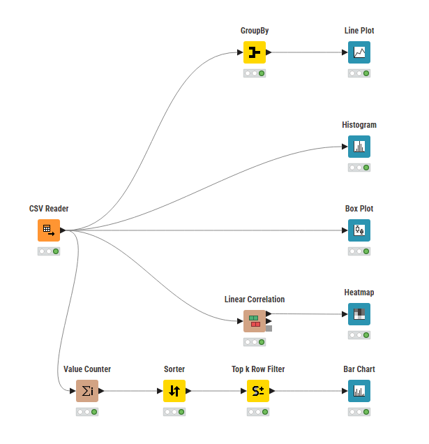

# Veri Görselleştirme: ABD İç Hat Uçuş Gecikmeleri (KNIME + Python)

Aralık 2008 ABD iç hat uçuşlarından 50.000 kayıt üzerinde temel grafik türleriyle keşifsel veri analizi. Aynı sorular önce **KNIME**, sonra **Python** (matplotlib, seaborn, plotly) ile yanıtlandı. Grafik türlerinin ve kütüphanelerin karşılaştırıldığı bir araştırma raporu da eklendi.



## Sorular ve grafikler

| Soru | KNIME | Python |
|---|---|---|
| Ayın günlerine göre ortalama varış gecikmesi nasıl değişiyor? | GroupBy (DayofMonth, ort. ArrDelay) → Line Plot | `groupby` + `plt.plot` |
| Varış gecikmeleri nasıl dağılıyor? | Histogram (ArrDelay) | `plt.hist` |
| Havayolları arasında gecikme farkı var mı? | Box Plot (ArrDelay, UniqueCarrier'a göre) | `sns.boxplot` |
| Gecikme, mesafe ve uçuş süresi arasındaki ilişki | Linear Correlation → Heatmap | `df.corr()` + `sns.heatmap` |
| En yoğun 10 kalkış havalimanı | Value Counter (Origin) → Sorter → Top k Row Filter → Bar Chart | `value_counts().head(10)` + `px.bar` |

## Klasör yapısı

```
knime/       KNIME_data_visualisation.knwf, iş akışı görseli (png/svg)
notebooks/   data_visualisation.ipynb (çalıştırılmış, grafik çıktılarıyla)
docs/        Veri_Gorsellestirme_Arastirma_Raporu.docx (grafik türleri ve Python kütüphaneleri araştırması)
data/        airline_dec_2008_50k_modified2.csv (eksik ArrDelay satırları çıkarılmış örneklem)
```

## Çalıştırma

**KNIME:** File → Import KNIME Workflow → `knime/KNIME_data_visualisation.knwf`. Ardından CSV Reader düğümünün dosya yolunu `data/airline_dec_2008_50k_modified2.csv` olarak güncelleyin.

**Python:**
```bash
pip install -r requirements.txt
jupyter notebook notebooks/data_visualisation.ipynb
```

Veri: [ASA Data Expo 2009, Airline On-Time Performance](https://community.amstat.org/jointscsg-section/dataexpo/dataexpo2009) (Ekim 1987 – Nisan 2008 arası ABD ticari uçuşları; burada Aralık 2008'den 50.000 kayıtlık örneklem).
